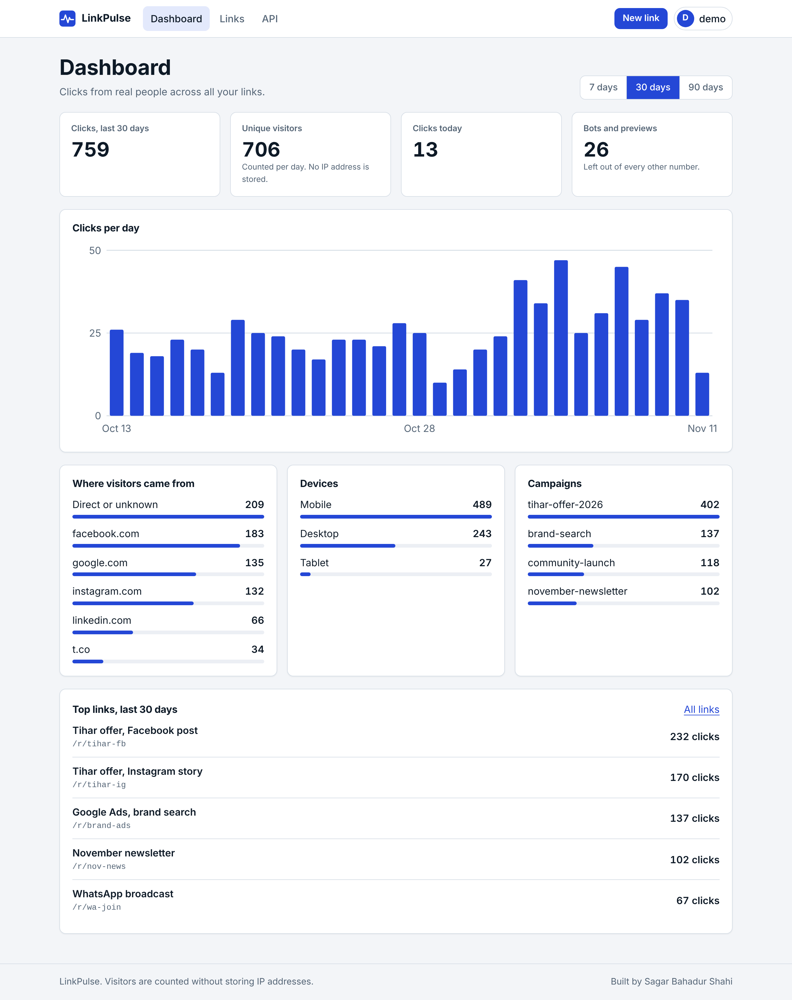
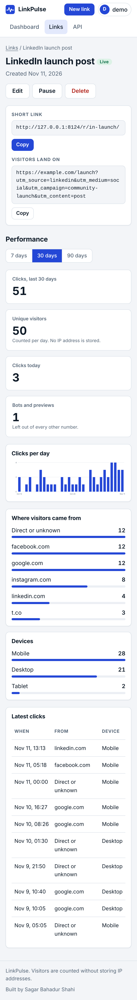
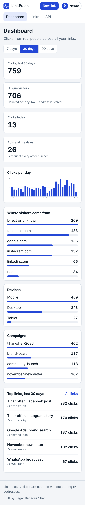

# LinkPulse

Campaign link tracking for marketers. Turn any web address into a tagged short link,
then see which post, email or ad really brings visitors. Built with Django 5.2 and
Django REST Framework, with privacy and security as design constraints rather than afterthoughts.



| Link detail (phone) | Dashboard (phone) |
|---|---|
|  |  |

## What it does
- **Short links** with an auto-generated or custom code (`/r/diwali-sale/`), optional expiry, pause/resume.
- **UTM tagging** done for you: source, medium, campaign, content, term, with quick-fill buttons (Facebook, Google Ads, Email...). Values are normalised so `Tihar Offer 2026!` becomes `tihar-offer-2026`.
- **Analytics** for 7/30/90 days: clicks per day, unique visitors, referrers, devices, campaigns, top links, latest clicks. Bots and link-preview crawlers are detected and left out of every number.
- **Privacy by design**: no IP address or user-agent is stored. A click keeps only the referrer *site name*, a device class and a daily salted hash used to count unique visitors.
- **REST API** with API keys (`/api/v1/`) for links and stats.
- **CSV export** of your links and click counts.
- Light and dark theme, responsive layout, no JavaScript charting library (charts are server-rendered SVG), system fonts only.

## Quick start
```bash
python -m venv .venv && source .venv/bin/activate
pip install -r requirements.txt
cp .env.example .env            # sets DJANGO_DEBUG=True for local development only
python manage.py migrate
python manage.py seed_demo      # optional: demo account "demo" with sample clicks (DEBUG only)
python manage.py runserver
```
Open http://127.0.0.1:8000/. Create an account, or log in as the demo user printed by `seed_demo`.

Run the tests: `python manage.py test` (189 tests, no setup needed).

## API
Create a key on the **API** page (shown once, stored only as a SHA-256 hash). Send it as a Bearer token.
All responses are JSON; list endpoints are paginated (`page`, `page_size` up to 100).

| Method | Path | Purpose |
|---|---|---|
| GET / POST | `/api/v1/links/` | List / create links |
| GET / PUT / PATCH / DELETE | `/api/v1/links/{id}/` | Read / change / remove a link (code cannot change) |
| GET | `/api/v1/links/{id}/stats/?days=30` | Totals, daily series, referrers, devices (`days` 1-365) |

```bash
curl -H "Authorization: Bearer lp_..." -H "Content-Type: application/json" \
  -d '{"destination_url":"https://example.com/offer","utm_source":"facebook","utm_medium":"social"}' \
  http://127.0.0.1:8000/api/v1/links/
```
Fields the server controls (`owner`, `id`, `short_url`, `click_count`, timestamps) are ignored if sent.
Other users' links return `404`. Limits: 120 requests/min per user, 20/min anonymous, repeated bad keys are blocked.

## Security
Both of your checklists are applied. "N/A" means the feature does not exist in this project, so there is nothing to protect.

| Item | Status | Where |
|---|---|---|
| Hide API keys / check env variables | Done | Config comes from environment variables; `.env` is git-ignored; production refuses to start without `DJANGO_SECRET_KEY` and `DJANGO_ALLOWED_HOSTS`. API keys are shown once and stored hashed. |
| Purge / scan Git for secrets | Done | A test scans every tracked file for secret patterns and checks `.env` is not tracked. No secrets were ever committed. |
| Public DB key, RLS | N/A | No Supabase-style client-side database access. The database is only reachable from the server. |
| Encrypt sensitive data / secure database | Partly | Passwords and API keys are hashed (never stored). Nothing else sensitive is stored. Disk-level or database encryption is the host's job; use TLS to a managed database via `DATABASE_URL`. |
| Server-side auth, proper authentication | Done | Django sessions for the web app, Bearer API keys for the API; every view requires login. |
| Lock record access, access control | Done | Every query is scoped to the owner; other users' objects return 404. Tested for each page and API route. |
| Block field tampering | Done | Explicit field whitelists; owner, id, counts and timestamps cannot be set; a link's code cannot be changed. |
| Secure session cookies | Done | `Secure`, `HttpOnly`, `SameSite` in production; visitors on short links get no cookies. |
| Hash passwords | Done | Argon2, with Django's password validators. |
| Rate limit login, bot protection | Done | Login lockout per IP+username, admin lockout, registration limits plus a honeypot field, redirect and API throttles. |
| Parameterize queries | Done | Django ORM only; no raw SQL. |
| Validate / sanitize all input | Done | Destination URLs allow only http/https, no credentials, no private or local addresses, no own site, length limits. UTM values and codes are normalised. |
| Escape user content, XSS | Done | Template auto-escaping, no `|safe`, strict CSP with no inline scripts or styles (tests check this), CSV formula-injection guard. |
| Restrict file uploads | N/A | There are no uploads. |
| Trim API responses | Done | Serializer whitelists fields; no internal data is exposed. |
| Secure API endpoints, CORS | Done | JSON only, auth and throttles on every route, CSRF on session auth. CORS is not enabled, so browsers on other sites cannot call the API. |
| Security headers | Done | CSP, HSTS, X-Frame-Options DENY, nosniff, Referrer-Policy, Permissions-Policy, no-store on redirects. |
| Force HTTPS | Done | SSL redirect and HSTS in production (verified with gunicorn behind a simulated proxy). |
| Protect admin routes | Done | Admin moved off `/admin/` (set `ADMIN_URL`), login lockout, production-only strong settings. |
| Debug mode off | Done | Off unless `DJANGO_DEBUG=True`; a test starts the app without it and checks it refuses weak production config. |
| Update dependencies, scan, remove unused | Done | `pip-audit` reports no known vulnerabilities (it caught an old DRF release, now upgraded); `bandit` is clean; CI runs both. Only needed packages are listed. |
| Check exposed files | Done | Only collected static files are served; the `.env`, database and source are never under a served path. |
| Full security audit | Done by me, not by a third party | Automated scans and tests above. Not an independent penetration test. |

See [SECURITY.md](SECURITY.md) to report a problem.

## Deploying
1. Set environment variables (see `.env.example`): `DJANGO_SECRET_KEY` (long random value), `DJANGO_ALLOWED_HOSTS`, `DJANGO_CSRF_TRUSTED_ORIGINS=https://your.domain`, and `DJANGO_TRUSTED_PROXY_COUNT=1` when behind one reverse proxy. Optionally `DATABASE_URL` (Postgres recommended), `ADMIN_URL`, `DJANGO_TIME_ZONE`.
2. Raise `DJANGO_HSTS_SECONDS` (for example `31536000`) once HTTPS works everywhere.
3. `python manage.py migrate && python manage.py collectstatic --noinput`, then `gunicorn linkpulse.wsgi`.
4. Check with `python manage.py check --deploy`.

A `Dockerfile` (non-root user) is included. It has not been built in the environment where this was written, so test it before relying on it.
Rate limits use Django's cache; with several server processes, configure a shared cache such as Redis for exact limits.

## Project layout
`core/` security headers, throttling, admin lockout, error pages · `accounts/` registration, login, API keys · `links/` models, validators, tracking, analytics, views, API · `templates/`, `static/` frontend · `.github/workflows/ci.yml` tests, deploy check, bandit, pip-audit.

Built by Sagar Bahadur Shahi.
